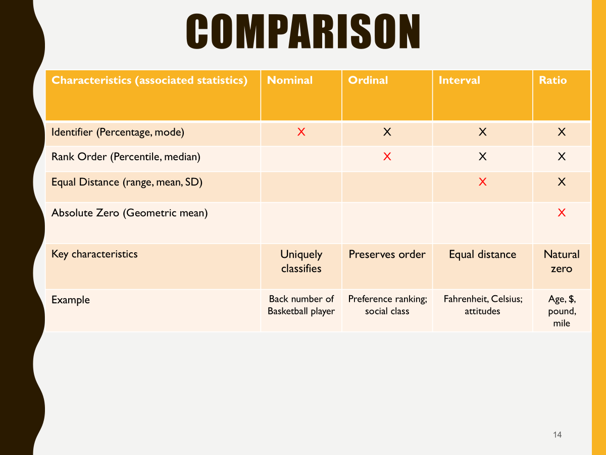

## Overview {.unnumbered}

> *In this assignment, you will prepare survey data for analysis using R and Quarto. The data come from Case 31, Employees Federal Credit Union. You will read an SPSS data file, inspect it, document the survey variables, clean coding problems, reverse code selected items, and decide whether two multi item measures can be combined into indexes.*

This report walks through every preparation step on the EFCU member opinion survey so another analyst can rerun it from the raw SPSS file and land on the same cleaned dataset. The questionnaire (Case Exhibit 31.1) and the coding sheet (Case Exhibit 31.2) were kept open the whole time and are cited wherever a decision depends on them.

## Files and software {.unnumbered}

The project folder holds `Case 31 Data_efcu_1.sav`, `Case 31 - Employees Federal Credit Union.PDF`, and this QMD file. Packages were installed once from the Console, never inside this document.

```{r}
#| label: setup

library(tidyverse)
library(haven)
library(labelled)
library(sjPlot)
library(psych)
library(skimr)
library(gt)
set_theme(theme_minimal())
```

## Four Types of Measurement Scales {.unnumbered}



## Import and inspect the SPSS data

`read_sav()` reads the SPSS file and keeps the variable labels and value labels as metadata. By default (`user_na = FALSE`), values that SPSS flags as user defined missing are converted to ordinary `NA`.

```{r}
#| label: import
data_raw <- read_sav("Case 31 Data_efcu_1.sav")
```

```{r}
#| label: inspect
dim(data_raw)
names(data_raw)
glimpse(data_raw)
skim(data_raw)
summary(data_raw)
```

### Questions to answer

> *1. How many rows and columns are in the imported data? 2. What are the variable names? 3. Which variables look like questionnaire items, and which look like precomputed variables? 4. What is the difference between a variable label and a value label? 5. Which variables contain missing values?*

The file has 128 rows (one per returned questionnaire) and 34 columns. Thirty two of the columns are named after question numbers: q3 to q27, q30 to q34, q37, and q38. Questions 1, 2, 28, 29, 35, 36, 39, and 40 are not in the file, which makes sense because most of those are screening, check all that apply, or open ended questions.

The remaining two columns, `OverallEmployeePerformace` (misspelled in the file) and `employeeperformance`, are not questions at all. They hold values such as 2.75 and 4.25, which a five point item can never produce, and they have no variable label. Both turn out to equal the average of q3 to q6 for every respondent, so they are precomputed summaries that someone added after data entry.

A variable label describes the question itself (q3 is "Employees are Courteous"). A value label describes what a specific code means inside that question (for q3, 1 means "Strongly Disagree"). The first tells you what was asked; the second tells you how to read the answer.

Only three variables have missing values, shown in the table below: q7 (10 missing), q8 (21 missing), and q37 (7 missing). These line up with the "No Opinion" option on the two rate questions and on the overall rating, which suggests those 6 codes were already stored as missing in the SPSS file.

```{r}
#| label: missing-raw
data_raw |>
  summarise(across(everything(), \(x) sum(is.na(x)))) |>
  pivot_longer(everything(), names_to = "variable", values_to = "n_missing") |>
  filter(n_missing > 0)
```

## Create a data dictionary

SPSS files store metadata that is not visible in the data frame itself. `haven` keeps it as attributes. The chunk below builds a compact dictionary with each variable's label, class, number of distinct values, and value labels.

```{r}
#| label: dictionary
data_dictionary <- tibble(
  variable = names(data_raw),
  variable_label = map_chr(data_raw, \(x) attr(x, "label") %||% ""),
  class = map_chr(data_raw, \(x) class(x)[1]),
  n_distinct = map_int(data_raw, n_distinct),
  value_labels = map_chr(
    data_raw,
    \(x) {
      labs <- attr(x, "labels")
      if (is.null(labs)) "" else str_c(labs, "=", names(labs), collapse = "; ")
    }
  )
)

data_dictionary |> gt()
```

```{r}
#| label: dictionary-easy
data_raw |> view_df()
```

### Questions to answer

> *1. Which variables have clear, useful labels? 2. Which labels should be revised for readability in your report? 3. Which variables are nominal, ordinal, or approximately interval for this assignment? Explain at least three, using the questionnaire. 4. Which value labels are essential for interpreting the data, and which are predictable from the response scale?*

The employee items (q3 to q6), the statement items (q10 and q11), the product list (q13 to q26), and q27 all have labels that match the questionnaire closely enough to use as is. "Employees are Courteous" or "IRA loans" needs no translation.

Several labels need work before they go in a report. The biggest problem is q8: its label reads "statement frequency," which is a copy of q9's label, but the questionnaire shows q8 asks about the rates the credit union charges members to borrow. q7 "savings rates" would read better as "Rates paid on share (savings) accounts." The q30 to q34 labels use the "CU" shorthand and lose meaning; "CU rates lower" is really "Credit union loan rates are lower than other institutions." q38 "headquarter" should say "Lives in the headquarters area." Capitalization is also inconsistent across the file.

Measurement levels, matched to the questionnaire:

**Nominal.** q11, q12, q27, and q38 are yes or no questions, so the numbers only name categories. q13 to q26 are also nominal in a strict sense: "aware and have used," "aware but have not used," and "unaware" are kinds of experience with a product, not points on a good to bad scale.

**Ordinal.** q7 and q8 run from "very high" to "very low," q9 runs from "too often" to "never," q10 runs from "excellent" to "poor," and q37 runs from "excellent" to "very poor." Each has a clear order, but the distance between "average" and "high" is not guaranteed to equal the distance between "high" and "very high."

**Approximately interval.** q3 to q6 and q30 to q34 are five point agreement (Likert type) items. Strictly they are ordinal, but in marketing research it is standard to treat them as interval so they can be averaged and correlated, which is exactly what the reliability check later in this report does.

The value labels that a reader truly needs are the ones that cannot be guessed from the scale: the special codes (6 = "No Opinion" on q7, q8, and q37; 3 = "No answer" on the yes or no items; 3 = "Unaware" on q13 to q26) and the direction of each ordinal scale, because on q7, q8, q10, and q37 the number 1 is the *top* of the scale, which is the opposite of what most people assume. The agreement labels on q3 to q6 and q30 to q34 are predictable: once you know 1 is strongly disagree and 5 is strongly agree, codes 2 to 4 follow naturally.

Keep `data_raw` unchanged as a reference copy. All cleaning happens on a copy.

## Improve the metadata with the case coding instructions

Labels are documentation that travels with the data. Stripping them (for example with `as.numeric()`) throws that documentation away, so the labels are kept and repaired where they are incomplete.

### Coding instructions (Case Exhibit 31.2)

| Response scale | Coding |
|------------------------------------|------------------------------------|
| Strongly disagree to strongly agree | Strongly disagree = 1; strongly agree = 5 |
| Very high to very low | Very high = 1; very low = 5; no opinion = 6 |
| Too often to never | Too often = 1; never = 5 |
| Excellent to poor | Excellent = 1; poor = 4 |
| Excellent to very poor | Excellent = 1; very poor = 5; no answer = 6 |
| Yes/no | Yes = 1; no = 2; no answer = 3 |
| Awareness/use | Aware and have used = 1; aware but have not used = 2; unaware = 3 |

Matching the exhibit to the questionnaire: q3 to q6 and q30 to q34 are the agreement items; q7 and q8 use very high to very low; q9 is the frequency item; q10 is excellent to poor; q37 is excellent to very poor; q11, q12, q27, and q38 are yes or no; and q13 to q26 are awareness and use items.

> *Compare this table with the value labels you printed in Section 2. Which codes in the file have no label?*

Comparing the dictionary against the exhibit turns up four gaps. On the ten agreement items (q3 to q6, q30 to q34) only the end points 1 and 5 are labeled, so codes 2, 3, and 4 have no label even though most answers land there. On the four yes or no items (q11, q12, q27, q38) code 3 "no answer" is missing, and this matters because q12 actually contains 22 respondents coded 3. On the awareness items (q13 to q26) code 3 "unaware" is missing, even though it is the single most common answer on several products (83 of 128 on q13). Finally, q37 labels code 6 as "No Opinion" while the exhibit calls it "no answer," so that label is wrong rather than missing.

### Add, edit, and remove labels

A quick demonstration on a single variable (nothing is saved):

```{r}
#| label: label-demo
var_label(data_raw$q7)
val_labels(data_raw$q7)

# Add a label to one code, then strip all value labels
data_raw$q7 |> add_value_labels("Refused" = 7) |> val_labels()

data_raw$q7 |> add_value_labels("Refused" = 7)
data_raw$q7 |> var_label()
data_raw$q7 |> remove_var_label() |> var_label()
data_raw$q7 |> val_labels()
```

### Fixing metadata problems

The chunk below fills every labeling gap found above using Case Exhibit 31.2: full agreement labels on the ten Likert items, "Unaware" on the awareness items, "No answer" on the yes or no items, and a corrected label set on q37.

```{r}
#| label: add-labels

# Agreement Likert type scale value labels
five_pt_likert <- c(
  "Strongly Disagree" = 1,
  "Disagree" = 2,
  "Uncertain" = 3,
  "Agree" = 4,
  "Strongly Agree" = 5
)

data_labelled <- data_raw |>
  mutate(
    across(c(q3:q6, q30:q34), \(x) add_value_labels(x, five_pt_likert))
  )

# Missing "unaware" and "no answer" codes, plus the corrected q37 set
data_labelled <- data_labelled |>
  mutate(
    across(q13:q26, \(x) add_value_labels(x, "Unaware" = 3)),
    across(c(q11, q12, q27, q38), \(x) add_value_labels(x, "No answer" = 3)),
    q37 = set_value_labels(
      q37,
      c(
        "Excellent" = 1,
        "Good" = 2,
        "Average" = 3,
        "Poor" = 4,
        "Very Poor" = 5,
        "No answer" = 6
      )
    )
  )

val_labels(data_labelled$q13)
val_labels(data_labelled$q11)
val_labels(data_labelled$q37)
```

> *Notice that q8's variable label in the file ("statement frequency") duplicates q9's label, but q8 uses the very high to very low scale. Check the questionnaire for what q8 asks. How would you relabel it with `set_variable_labels()`?*

The questionnaire asks in q8 for the member's opinion of the rates the credit union charges members to borrow funds. So q8 is about loan rates, the mirror image of q7, which asks about rates paid on share (savings) accounts. While fixing q8, the chunk below also cleans up the other labels flagged in Section 2 so the final dataset reads well in any output.

```{r}
#| label: fix-variable-labels
data_labelled <- data_labelled |>
  set_variable_labels(
    q3  = "Employees are courteous",
    q4  = "Employees are helpful",
    q5  = "Employees are professional",
    q6  = "Employees are always available",
    q7  = "Rates paid on share (savings) accounts",
    q8  = "Rates charged to members to borrow funds",
    q9  = "Frequency of account statements",
    q10 = "Accuracy of statements",
    q11 = "Statements are easy to understand",
    q12 = "Account information kept confidential",
    q30 = "CU loan rates are lower than other institutions",
    q31 = "CU personnel keep financial information confidential",
    q32 = "CU is prompt in processing loan applications",
    q33 = "CU financial services meet members' needs",
    q34 = "CU loan applications are simple and easy",
    q37 = "Overall rating of how the CU is managed and operated",
    q38 = "Lives in the headquarters area"
  )

var_label(data_labelled$q8)
view_df(data_labelled)
```

## Create an analysis copy

The analysis copy keeps only the questionnaire variables (names that start with `q` followed by a number). Labels come along.

```{r}
#| label: analysis-copy
data <- data_labelled |>
  select(matches("^q\\d+$"))

names(data)
```

Before dropping them, a quick check confirms what the two precomputed variables actually are.

```{r}
#| label: precomputed-check
data_raw |>
  mutate(mean_q3_q6 = rowMeans(across(q3:q6))) |>
  summarise(
    matches_overall = all(near(OverallEmployeePerformace, mean_q3_q6)),
    matches_employee = all(near(employeeperformance, mean_q3_q6))
  )
```

> *Explain why using an already computed index could be a problem when the purpose of this assignment is to evaluate and construct measures.*

Both precomputed columns are the plain average of q3 to q6, and they are identical to each other. Nothing in the file says who built them, whether anyone checked reliability first, how missing answers were handled, or whether any item was reversed. Using them would mean accepting the conclusion ("these four items form one score") before doing the work that is supposed to justify it. The point of this assignment is to test whether an index is warranted and then build it in a documented way, so a ready made score would skip the evaluation entirely and could carry hidden mistakes into later analysis. Keeping them in `data_raw` preserves them as a reference without letting them leak into the analysis.

### Data quality checks

```{r}
#| label: quality-checks
data |>
  mutate(across(everything(), as.numeric)) |>
  pivot_longer(everything(), names_to = "variable") |>
  summarise(
    values_observed = str_c(sort(unique(value)), collapse = ", "),
    n_missing = sum(is.na(value)),
    pct_missing = round(mean(is.na(value)) * 100, 1),
    .by = variable
  ) |>
  gt()
```

> *Compare these values with the questionnaire. Does any variable contain a value that the questionnaire does not define?*

No variable has a value outside the codes in Case Exhibit 31.2, so there are no typos such as a 7 on a five point item. There is one value the printed questionnaire does not show, though: q12 has 22 respondents coded 3. The questionnaire only offers yes and no on q12; code 3 comes from the coding sheet and means the person left it blank. That is a nonresponse, not an answer, so it is treated as missing in the next section along with the other special codes.

A few patterns are worth noting even though they are valid. q9 only contains 3 ("about right") and 4 ("not often enough"), so nobody felt they got statements too often. q26 has no 3s, meaning every respondent knew line of credit loans existed. Missing data is limited to q7 (7.8%), q8 (16.4%), and q37 (5.5%).

## Recode special responses and reverse code items

Reverse coding is needed when a larger number represents a less favorable response than a smaller number. After reverse coding, larger values should mean the same thing across all items that will be combined.

### "No Opinion" and "No answer" responses

According to Exhibit 31.2, q7 and q8 use 6 for "No Opinion," and q37 uses 6 for "No answer." Neither is a rating, so both are treated as missing. First check whether any 6s remain.

```{r}
#| label: check-no-opinion
data |>
  summarise(across(c(q7, q8, q37), \(x) sum(x == 6, na.rm = TRUE)))
```

The count is 0 for all three, so the 6s were already converted to `NA` on import (they match the missing counts in Section 1). The recode below still runs because it guarantees the result no matter how the file is read. The same logic applies to code 3 ("No answer") on the four yes or no items, which is where the 22 nonresponses on q12 are handled.

```{r}
#| label: recode-no-opinion
data <- data |>
  mutate(
    across(c(q7, q8, q37), \(x) na_if(x, 6)),
    across(c(q11, q12, q27, q38), \(x) na_if(x, 3))
  )

data |> count(q12)
```

### Reverse coding

Items reversed, using `reversed = minimum + maximum - original`:

-   q7, q8, and q37: 1 to 5 scales where 1 is the top ("very high" or "excellent"), so the formula is `6 - x`
-   q10: a 1 to 4 scale where 1 is "excellent," so the formula is `5 - x`

Arithmetic on a labelled variable returns a plain number, so the old labels are dropped. That is the right behavior because they would now be wrong. New variable and value labels describing the reversed direction are attached below.

```{r}
#| label: reverse-code
data <- data |>
  mutate(
    q7r = 6 - q7,
    q8r = 6 - q8,
    q10r = 5 - q10,
    q37r = 6 - q37
  ) |>
  set_variable_labels(
    q7r = "Savings rates paid (reversed: higher = higher rates)",
    q8r = "Loan rates charged (reversed: higher = higher rates)",
    q10r = "Statement accuracy (reversed: higher = better)",
    q37r = "Overall rating (reversed: higher = better)"
  ) |>
  set_value_labels(
    q7r = c(
      "Very Low" = 1,
      "Low" = 2,
      "Average" = 3,
      "High" = 4,
      "Very High" = 5
    ),
    q8r = c(
      "Very Low" = 1,
      "Low" = 2,
      "Average" = 3,
      "High" = 4,
      "Very High" = 5
    ),
    q10r = c("Poor" = 1, "Fair" = 2, "Good" = 3, "Excellent" = 4),
    q37r = c(
      "Very Poor" = 1,
      "Poor" = 2,
      "Average" = 3,
      "Good" = 4,
      "Excellent" = 5
    )
  )
```

One caution on q8r. After reversal, a higher number means the member thinks loan rates are *higher*. For q7 (rates the credit union pays on savings) that is good news for the member, but for q8 (rates the credit union charges on loans) it is bad news. So q8r runs in the opposite favorability direction from q7r, q10r, and q37r, and it should not be averaged with them. For any analysis about member satisfaction, the original q8 coding (1 = very high, 5 = very low) already runs from least to most favorable.

Two sets of items are deliberately **not** reversed:

-   **q9** (frequency of statements): the labels run from "Too Often" through "About Right" to "Never," and the best answer is in the middle.
-   **q13 to q26** (awareness and use of products): the categories describe kinds of experience, not a rating from bad to good.

#### Questions to answer

> *1. Why is a reversal inappropriate for q9? How could you code q9 to answer "was the frequency about right?" instead?*

Reversing q9 would just flip "too often" and "never," and both ends are complaints. The ideal answer, "about right," is code 3, and it would stay code 3 after reversal, so the reversed scale would still not run from bad to good. A better approach is to recode q9 into a yes or no indicator: 1 if the answer was "about right" (code 3) and 0 for anything else. If direction matters too, a three group version works: "too often" (1 or 2), "about right" (3), and "not often enough" (4 or 5). In this sample that split is simple because only codes 3 and 4 appear: 99 respondents said about right and 29 said not often enough.

```{r}
#| label: q9-about-right
data <- data |>
  mutate(
    q9_about_right = if_else(q9 == 3, 1, 0),
    q9_about_right = labelled(
      q9_about_right,
      labels = c("Not about right" = 0, "About right" = 1),
      label = "Statement frequency was about right"
    )
  )

data |> count(q9, q9_about_right)
```

> *2. Why should q13 to q26 not be reversed or averaged into one score? What would be a more appropriate way to summarize them?*

The three codes are labels for different situations, not amounts of anything. Averaging them would produce numbers like 2.1 that have no meaning, and it would blend two separate ideas (awareness and actual use) into one score. It would also treat fourteen very different products as if they measured one trait, when knowing about a Christmas club account says little about whether someone has a car loan. A better summary is a frequency table for each product showing the percent who are unaware, aware but not using, and using. That directly answers the board's question about how informed members are. Count based summaries also work well, such as the number of products each member is aware of (codes 1 or 2) and the number they have used (code 1).

#### Awareness items as an ordinal scale

> *Task: Let's suppose you want to treat awareness questions (q13 through q26) as an ordinal scale and thus want to create new variables by reverse coding them. Write the code below.*

If the codes are read as an order of engagement (unaware, then aware, then aware and used), the original direction runs backward because 1 is the most engaged. Reversing with `4 - x` makes higher numbers mean more engagement. This is done as the exercise asks, with the caveat above that these remain categories at heart.

```{r}
#| label: awareness-ordinal
aware_vars <- str_c("q", 13:26)
aware_vars_r <- str_c(aware_vars, "r")

data <- data |>
  mutate(
    across(all_of(aware_vars), \(x) 4 - as.numeric(x), .names = "{.col}r"),
    across(
      all_of(aware_vars_r),
      \(x) labelled(
        x,
        labels = c(
          "Unaware" = 1,
          "Aware but have not used" = 2,
          "Aware and have used" = 3
        )
      )
    )
  )

# Carry over each item's label with a note on direction
var_label(data[aware_vars_r]) <- map(
  aware_vars,
  \(v) str_c(var_label(data[[v]]), " (reversed: higher = more engaged)")
)

data |> count(q13, q13r)
```

### Verify the recoding

```{r}
#| label: verify-recode
data |> count(q7, q7r)
data |> count(q8, q8r)
data |> count(q10, q10r)
data |> count(q37, q37r)
```

The cross tabulations confirm every check. "No Opinion" is missing for q7, q8, and q37, and the missing rows stay missing in the reversed versions. On each item the lowest original code maps to the highest reversed code and the highest maps to the lowest (for example, q10 = 1 "excellent" became q10r = 4). After reversal, larger values on q7r, q10r, and q37r mean a more favorable response for the member. q8r is the one exception, as explained above, because high loan rates are unfavorable.

## Evaluate candidate multi item measures

Two groups of items may form multi item measures:

1.  Employee proficiency: q3 through q6.
2.  Operational effectiveness: q30 through q34.

Reliability (Cronbach's alpha) and a quick one factor analysis are used as evidence. Statistical functions such as `psych::alpha()` expect plain numbers, so the labels are removed from the item sets only.

### Employee proficiency

```{r}
#| label: employee-alpha
employee_items <- data |>
  select(q3:q6) |>
  remove_val_labels() |>
  remove_var_label()

employee_alpha <- psych::alpha(employee_items)

employee_alpha$total
employee_alpha$item.stats
```

```{r}
#| label: employee-fa
employee_fa <- psych::fa(
  employee_items,
  nfactors = 1,
  rotate = "none",
  fm = "minres"
)

employee_fa$loadings
employee_fa$communality
```

### Operational effectiveness

```{r}
#| label: operations-alpha
operations_items <- data |>
  select(q30:q34) |>
  remove_val_labels() |>
  remove_var_label()

operations_alpha <- psych::alpha(operations_items)

operations_alpha$total
operations_alpha$item.stats
operations_alpha$alpha.drop
```

```{r}
#| label: operations-fa
operations_fa <- psych::fa(
  operations_items,
  nfactors = 1,
  rotate = "none",
  fm = "minres"
)

operations_fa$loadings
operations_fa$communality
```

### Questions to answer

> *For each candidate measure: 1. What is the reliability estimate (raw_alpha)? 2. Do the item total statistics (r.drop) suggest every item contributes? Does any item correlate weakly or negatively with the rest? 3. Do the factor loadings support one common factor? 4. Is a one factor interpretation reasonable given the item wording? 5. Do you recommend creating an index?*

**Employee proficiency (q3 to q6).** Raw alpha is about 0.87, which is strong for a four item set. Every item contributes: the corrected item total correlations (r.drop) run from about 0.66 (courteous) to 0.82 (helpful), none are weak or negative, and dropping any single item would lower alpha rather than raise it. In the one factor solution all four loadings are high, from about 0.72 (courteous) to 0.92 (helpful), and the single factor accounts for roughly 63% of the variance. The wording backs this up, since all four statements ask the member to rate the same people (credit union employees) on closely related qualities, on the same agreement scale, and in the same direction. No item needs reversing. **Recommendation: create the index.**

**Operational effectiveness (q30 to q34).** Raw alpha is only about 0.54. The r.drop values are all on the low side, from about 0.22 (q33, meets members' needs, and q34, simple loan applications) up to about 0.48 (q32, prompt processing). None are negative, so this is not a reversed wording problem, and removing any one item does not help. The one factor solution is lopsided: q32 loads strongly (about 0.79), while the other four load between roughly 0.30 and 0.40 and share very little variance with the factor (about 23% overall). Several pairs barely relate at all; q31 (confidentiality) and q34 (simple applications) correlate at essentially zero. Reading the wording explains why. These five statements cover different topics: loan rate competitiveness, privacy, loan processing speed, overall fit of services, and form simplicity. They are each about operations, but a member can feel very differently about privacy than about loan rates. **Recommendation: do not create the index.** These items should be analyzed one at a time, for example with frequency tables, item means, and comparisons between members who live inside and outside the headquarters area (q38), which is one of the board's stated objectives.

### Create indexes only when justified

The employee proficiency index is created as each respondent's mean across q3 to q6, which keeps it on the original one to five agreement scale. The operational effectiveness index is left out for the reasons above.

```{r}
#| label: create-indexes
data <- data |>
  mutate(
    employee_proficiency_index = rowMeans(pick(q3:q6), na.rm = TRUE),
    across(ends_with("_index"), \(x) if_else(is.nan(x), NA_real_, x))
  ) |>
  set_variable_labels(
    employee_proficiency_index = "Employee proficiency index (mean of q3 to q6, 1 to 5)"
  )
```

```{r}
#| label: check-indexes
data |>
  select(ends_with("_index")) |>
  summary()
```

## Report your data preparation decisions

::: {.callout-note title="Data Preparation Narrative"}

The SPSS file was read with `haven::read_sav()`, which kept the variable and value labels and returned 128 respondents and 34 variables. The raw object was left untouched as a reference, and all cleaning was done on copies.

The data dictionary showed 32 questionnaire items and two unlabeled precomputed columns that turned out to be identical averages of q3 to q6. It also exposed incomplete metadata. The ten agreement items only had their end points labeled, the yes or no items were missing "no answer," the awareness items were missing "unaware," q37 called code 6 "No Opinion" instead of "no answer," and q8 carried q9's label even though it asks about loan rates. All of these were fixed using Case Exhibit 31.2, and several other variable labels were rewritten so they read clearly in output.

The analysis copy kept only the questionnaire items. The two precomputed columns were excluded because there is no record of how they were built and because the assignment is to test whether such a score is justified, not to assume it.

Special codes were set to missing because they are not ratings: 6 on q7, q8, and q37, and 3 ("no answer") on q11, q12, q27, and q38. The 6s had already been read in as missing, but the recode runs anyway as a safeguard. The only real change was on q12, where 22 nonresponses (about 17%) became missing. Missing data is otherwise limited to q7 (7.8%), q8 (16.4%), and q37 (5.5%), all from "No Opinion."

q7, q8, and q37 were reversed with `6 - x` and q10 with `5 - x`, and each got new labels describing the new direction. Cross tabulations confirmed that low and high codes swapped correctly and that missing stayed missing. q9 was not reversed because its best answer sits in the middle, so an "about right" indicator was created instead. q13 to q26 were not reversed for analysis because they are categories; reversed versions were built only for the ordinal exercise, with labels that state the direction. One interpretive caution: after reversal, higher q8r means higher loan rates, which is unfavorable to members, so q8r should not be combined with q7r, q10r, or q37r.

The employee items (q3 to q6) showed strong reliability (alpha about 0.87), high loadings on a single factor, and closely related wording, so an employee proficiency index was created as the item mean. The operations items (q30 to q34) showed weak reliability (alpha about 0.54) and a weak, lopsided single factor, and the wording covers five distinct topics, so no index was created and those items will be analyzed individually.

Limitations: the case text says 125 questionnaires were returned and two were discarded, but the file holds 128 rows, and that gap could not be explained from the materials provided. Open ended questions and several structured questions (q1, q2, q28, q29, q39) are not in the dataset, so objectives about why members borrow elsewhere cannot be fully answered with this file. Finally, alpha and a one factor check are a quick screen, not a full factor analysis.

:::

## Confirming completeness of data wrangling with data dictionary

```{r}
#| label: final-dictionary
data |> view_df()
```

## Save your work to a new SPSS file

The cleaned file includes the corrected labels, the missing value fixes, every reversed variable, the q9 indicator, and the employee proficiency index.

```{r}
#| label: save-spss
data |>
  write_sav("Case 31 Data_efcu_1_AN_cleaned.sav")
```

## Appendix: GitHub links

**Published report and repository:**

-   [View my GitHub Pages report](https://naran115.github.io/ic10-2-1-case31/Naranjo,%20Aldo-IC10-2-1-Data-Preparation-Case31.html)

-   [GitHub repo for Case 31](https://github.com/naran115/ic10-2-1-case31)
